# Music Fingerprinting — MATLAB


Projet académique — ESIEE Paris, E4  
OBL-4101 · Traitement du signal — Année 2026/2027  
Professeur : Amadou ASSOUMANE

> **Version de rendu.** Ce dépôt correspond à l'état final du projet,
> sur la branche `rendu-final`. Les résultats décrits ci-dessous sont
> ceux du rapport `report/Rapport_Reconnaissance_Musicale.pdf` ; aucun
> paramètre n'a été modifié après l'évaluation.

## 1. Présentation du projet

Ce projet implémente un système de reconnaissance musicale par
empreintes audio, sur le principe proposé par Wang (Shazam).

À partir d'un extrait de 3 à 10 secondes, pris à une position inconnue
et éventuellement dégradé, le système :

- identifie le morceau parmi une bibliothèque de 100 morceaux ;
- estime la position de l'extrait dans le morceau d'origine ;
- répond « inconnu » lorsque l'extrait n'appartient pas à la bibliothèque.

La chaîne complète est écrite en MATLAB, sans la Signal Processing
Toolbox. Elle est accessible par un programme principal (`main.m`) et
par une interface graphique (AudioID).

Le dépôt contient aussi les scripts d'évaluation (calibration, évaluation
indépendante, robustesse, analyse des échecs), les résultats exportés en
CSV et les figures du rapport.

## 2. Objectifs

- Identifier automatiquement un morceau à partir d'un extrait audio.
- Extraire des caractéristiques spectro-temporelles robustes.
- Générer des empreintes acoustiques compactes par paires de pics.
- Construire un index inversé permettant une recherche rapide.
- Estimer le décalage temporel entre une requête et un morceau de référence.
- Distinguer les morceaux connus des morceaux inconnus.
- Calibrer expérimentalement un seuil de décision.
- Évaluer les performances et la robustesse du système.
- Fournir une interface graphique de démonstration.

## 3. Principe de fonctionnement

```text
Signal audio
     |
     v
Pretraitement (mono, 8 kHz, normalisation)
     |
     v
TFCT (Hann, N = 1024, H = 512) -> spectrogramme en dB
     |
     v
Constellation : maxima locaux (+-3 trames, +-5 canaux, 6 bandes)
     |
     v
Empreintes : paires ancre-cible (k1, k2, dm)
     |
     v
Recherche dans l'index inverse
     |
     v
Alignement temporel : histogramme des decalages delta
     |
     v
Scores S1, S2 et decision (S1 >= seuil, sinon "inconnu")
```

### Prétraitement

Le signal est converti en mono (moyenne des voies), privé de sa
composante continue, filtré contre le repliement (RIF), rééchantillonné
à 8 kHz puis normalisé par son maximum (`preprocess_audio`).

La bande 0–4 kHz conserve en moyenne 96,8 % de la puissance des morceaux
de référence.

### Analyse temps-fréquence

La TFCT utilise une fenêtre de Hann de 1 024 échantillons et un pas de
512 (128 ms d'analyse, 64 ms entre deux trames, 7,8 Hz par canal).
Le spectrogramme est calculé en dB (`compute_spectrogram`).

Le rapport démontre qu'un gain ou un filtrage court n'ajoute qu'un biais
lent en fréquence et qu'un décalage temporel translate le spectrogramme :
la position des maxima locaux est donc conservée.

### Constellation de pics

`extract_peaks` retient les maxima locaux sur un voisinage de ±3 trames
et ±5 canaux, répartis sur 6 bandes géométriques entre 200 et 4 000 Hz,
avec au plus 5 pics par bande et par seconde.

La densité mesurée est de 26,2 pics/s, dans la plage de 25 à 35 pics/s
du sujet.

### Empreintes acoustiques

Chaque pic ancre est associé aux F = 10 premiers pics cibles d'une zone
située entre 0,1 et 2 s plus tard (Δm de 2 à 31 trames) et à moins de
60 canaux en fréquence.

La clé est le triplet (k1, k2, Δm), encodé en un entier :

```text
u = ((k1 - 1) * 513 + (k2 - 1)) * 32 + dm
```

Cette version ne quantifie pas les fréquences : elle correspond à
γf = 1 et à environ 7,9 × 10^6 clés possibles. La clé ne dépend pas
de l'instant absolu de l'extrait.

### Indexation

`build_index` range chaque clé dans un index inversé (`containers.Map`)
dont la valeur est la liste de toutes ses occurrences
(identifiant du morceau, instant d'ancre).

Pour les 100 morceaux de référence : 701 652 entrées pour
387 668 clés distinctes.

### Alignement temporel

Pour chaque clé commune, `match_audio` calcule le décalage
δ = m_ref − m_requête. Les paires correctes d'un même morceau votent
toutes pour le même décalage : le pic de l'histogramme donne le score S1
et la position estimée de l'extrait.

### Décision

`classify_match` compare le meilleur score S1 au seuil
`cfg.decision.threshold` = 22 votes. En dessous, la requête est déclarée
inconnue. S2 est le score du deuxième morceau candidat.

Le seuil a été calibré sur un ensemble séparé : plus grand score négatif
de calibration (18) plus une marge de 20 % (4 votes).

## 4. Technologies utilisées

- MATLAB (R2020b ou plus récent pour l'interface graphique)
- Traitement numérique du signal : TFCT, FFT, filtrage RIF
- Empreintes acoustiques et index inversé
- FFmpeg (expériences de compression MP3 uniquement)
- Python 3 et pandas (extraction des métadonnées uniquement)
- Git et GitHub

Aucune toolbox MATLAB n'est requise.

## 5. Structure du dépôt

Arborescence des fichiers versionnés sur la branche `rendu-final`
(les dossiers vides contiennent un `.gitkeep`) :

```text
music-fingerprinting-matlab/
|
|-- config.m                  Parametres communs
|-- main.m                    Programme principal
|-- README.md
|-- .gitignore
|
|-- src/                      Chaine de reconnaissance (version evaluee)
|   |-- preprocess_audio.m
|   |-- compute_spectrogram.m
|   |-- extract_peaks.m
|   |-- generate_hashes.m
|   |-- build_index.m
|   |-- query_index.m
|   |-- match_audio.m
|   |-- classify_match.m
|   |-- recognize_query.m
|   |-- apply_degradations.m
|   |-- apply_reverb.m
|
|-- gui/                      Interface graphique AudioID
|   |-- AudioID.m
|   |-- test_AudioID.m
|   |-- README.md
|
|-- data/
|   |-- metadata.csv          Metadonnees des 100 morceaux de reference
|   |-- references/           (vide : audio non versionne)
|   |-- negatives/            (vide : audio non versionne)
|   |-- queries/
|       |-- calibration_list.csv
|       |-- evaluation_list.csv
|
|-- experiments/
|   |-- setup_database.m
|   |-- create_queries.m
|   |-- test_spectrogram.m
|   |-- exp_peak_density.m
|   |-- calibrate_threshold.m
|   |-- sweep_threshold.m
|   |-- evaluate_system.m
|   |-- evaluate_robustness.m
|   |-- evaluate_noise_15db.m
|   |-- evaluate_babble.m
|   |-- evaluate_mp3.m
|   |-- evaluate_reverb.m
|   |-- analyze_failure.m
|   |-- analyze_errors_by_genre.m
|   |-- plot_results.m
|   |-- plot_robustness.m
|   |-- plot_roc.m
|   |-- plot_score_distributions.m
|   |-- plot_snr_by_duration.m
|
|-- tests/
|   |-- test_preprocessing.m
|   |-- test_peaks.m
|   |-- test_query_index.m
|   |-- test_alignment.m
|   |-- test_end_to_end.m
|
|-- results/
|   |-- calibration.mat            Seuil calibre
|   |-- evaluation.mat
|   |-- calibration_scores.csv
|   |-- evaluation_scores.csv
|   |-- evaluation_by_genre.csv
|   |-- threshold_sweep.csv
|   |-- robustness_results.csv
|   |-- robustness_details.csv
|   |-- noise_15db_results.csv
|   |-- noise_15db_details.csv
|   |-- snr_by_duration.csv
|   |-- babble_results.csv
|   |-- babble_details.csv
|   |-- mp3_results.csv
|   |-- reverb_results.csv
|   |-- errors.csv
|   |-- errors_with_metadata.csv
|   |-- tables/                    Densite et survie des pics
|   |-- figures/                   Figures PNG (300 dpi)
|   |-- indexes/                   (vide)
|
|-- scripts/
|   |-- extract_metadata.py
|
|-- contributions/
|   |-- thomas/                    Implementation distincte (voir section 17)
|
|-- report/
|   |-- Rapport_Reconnaissance_Musicale.pdf   Rapport final
|   |-- Rapport_Reconnaissance_Musicale.docx  Source editable du rapport
|   |-- experiments/                          Mesures complementaires du rapport
|   |   |-- run_all.m, run_complements.m, run_thomas_tests.m
|   |   |-- exp_theory.m, exp_survival.m, exp_gamma.m
|   |   |-- exp_index_cost.m, exp_complements.m
|   |   |-- rx_*.m                            Fonctions auxiliaires
|   |   |-- thomas_branch/                    Copie identique de contributions/thomas (src, tests)
|   |-- results/                              CSV et journaux de ces mesures
|
|-- presentation/                  (vide)
```

L'index `results/fingerprint_index.mat` et tous les fichiers audio
sont exclus de Git (voir section 8).

## 6. Configuration du système

Les paramètres communs sont définis dans `config.m`.

| Paramètre | Valeur |
|---|---:|
| Fréquence d'échantillonnage | 8 000 Hz |
| Taille de fenêtre N | 1 024 échantillons |
| Pas temporel H | 512 échantillons |
| Taille de FFT | 1 024 |
| Fenêtre d'analyse | Hann |
| Voisinage des maxima | ±3 trames, ±5 canaux |
| Bande de recherche des pics | 200 à 4 000 Hz |
| Nombre de bandes fréquentielles | 6 |
| Pics par bande et par seconde | 5 |
| Zone cible Δt | 0,1 à 2 s |
| Écart fréquentiel maximal Δk | 60 canaux |
| Cibles par ancre F (fan-out) | 10 |
| Quantification γf | aucune (équivalent γf = 1) |
| Seuil de décision | 22 votes |

**Important.** Dans `config.m`, `cfg.hash.gamma_f` et
`cfg.decision.threshold` valent `NaN`. Ce sont des valeurs de départ
volontairement non renseignées :

- la version évaluée de `generate_hashes` n'utilise pas `gamma_f` ;
- le seuil de 22 votes est produit par `calibrate_threshold.m`,
  enregistré dans `results/calibration.mat` (variable `threshold`) et
  dans la structure `cfg` sauvegardée avec l'index.

`main.m` et AudioID lisent donc la configuration **sauvegardée dans
`results/fingerprint_index.mat`**, et non celle de `config.m`.

## 7. Jeu de données

### Bibliothèque de référence

Les expériences utilisent le dataset FMA Small (Free Music Archive,
8 000 extraits d'environ 30 s) :
https://github.com/mdeff/fma

`setup_database.m` trie par nom les fichiers MP3 du dossier `fma_small`
choisi par l'utilisateur et retient les 100 premiers comme morceaux de
référence. Les fichiers 101 à 220 servent à générer les requêtes
négatives (60 pour la calibration, 60 pour l'évaluation).

### Métadonnées et liste des 100 morceaux

La liste des 100 morceaux de référence est fournie dans
`data/metadata.csv`, avec une ligne par morceau :

```text
song_id,title,artist,duration_s,file,set,source,licence,fma_id,genre
```

| Colonne | Contenu |
|---|---|
| `song_id` | Identifiant interne (1 à 100), égal à l'indice dans `audio_files` |
| `title`, `artist` | Titre et artiste issus des métadonnées FMA |
| `duration_s` | Durée du fichier en secondes |
| `file` | Chemin relatif dans `fma_small` (ex. `fma_small/000/000002.mp3`) |
| `set` | `reference` pour les 100 morceaux |
| `source`, `licence` | Free Music Archive et licence Creative Commons du morceau |
| `fma_id` | Identifiant FMA (numéro du fichier) |
| `genre` | Genre principal FMA |

Répartition par genre : Folk 32, Experimental 20, Rock 17,
International 15, Pop 10, Hip-Hop 5, Electronic 1.

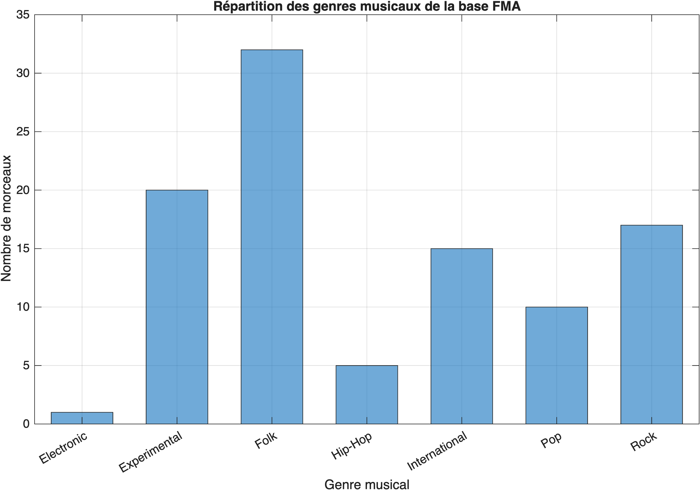

Ces métadonnées ont été extraites par `scripts/extract_metadata.py`, à
partir du fichier `tracks.csv` de `fma_metadata` et d'une liste des
fichiers indexés (`data/reference_files.csv`). Ce script n'est pas
nécessaire pour utiliser le système : `data/metadata.csv` est déjà
fourni. Les métadonnées n'interviennent pas dans le calcul des scores ;
elles servent uniquement à l'affichage.

### Requêtes expérimentales

Deux ensembles disjoints, générés par `create_queries.m` avec la graine
2026, séparent la calibration du seuil et l'évaluation des performances.

| Caractéristique | Calibration | Évaluation |
|---|---:|---:|
| Requêtes positives | 60 | 60 |
| Requêtes négatives | 60 | 60 |
| Extraits de 3 secondes | 40 | 40 |
| Extraits de 5 secondes | 40 | 40 |
| Extraits de 10 secondes | 40 | 40 |
| Total | 120 | 120 |

Les listes (`file`, `true_song_id`, `start_s`, `duration_s`) sont
versionnées dans `data/queries/` ; `true_song_id = 0` désigne une
requête négative. Les fichiers WAV des requêtes ne sont pas versionnés.

### Bruit réel

L'expérience de bruit réel utilise l'enregistrement « Ambiance de Bar #1 »
(LaSonothèque, son n° 480, licence CC0), attendu dans
`data/noise/babble.wav`. Ce fichier n'est pas versionné.

## 8. Dépôt GitHub et dossier de rendu

| Élément | Dépôt GitHub (`rendu-final`) | Dossier de rendu local |
|---|:---:|:---:|
| Code source (`src/`, `gui/`, `experiments/`, `tests/`, `main.m`) | oui | oui |
| Rapport PDF | oui | oui |
| Liste des morceaux (`data/metadata.csv`) | oui | oui |
| Résultats CSV et figures | oui | oui |
| Index `results/fingerprint_index.mat` (environ 287 Mo) | **non** | **oui** |
| Fichiers audio (FMA, requêtes WAV, bruit) | non | non requis pour la démonstration |

L'index `fingerprint_index.mat` est trop volumineux pour GitHub : il est
listé dans `.gitignore`. Il est **fourni dans le dossier de rendu local**,
à l'emplacement `results/fingerprint_index.mat`. Il contient les
variables `index`, `cfg` (dont le seuil de 22 votes) et `audio_files`.

Avec ce fichier en place, `main.m` et AudioID fonctionnent directement,
sans reconstruire la base. Depuis le seul dépôt GitHub, il faut
reconstruire l'index (section 10).

La variable `audio_files` contient les chemins absolus des fichiers MP3
sur la machine qui a construit l'index. Ces chemins ne servent qu'aux
scripts qui relisent les références (tests de bout en bout, expériences) ;
la reconnaissance d'une requête n'en a pas besoin.

## 9. Installation et lancement

### Prérequis

- MATLAB R2020b ou plus récent.
- Git.
- Pour reconstruire la base : le dataset FMA Small.
- Pour les expériences MP3 : FFmpeg.

### Clonage de la branche de rendu

```bash
git clone --branch rendu-final https://github.com/celya-bakala-yame/music-fingerprinting-matlab.git
cd music-fingerprinting-matlab
```

Copier ensuite `fingerprint_index.mat` depuis le dossier de rendu vers
`results/fingerprint_index.mat`.

### Chemin MATLAB : avertissement

Ouvrir MATLAB à la racine du projet et ajouter **uniquement** les
dossiers nécessaires :

```matlab
addpath('src');
addpath('gui');
```

> **Ne pas utiliser `addpath(genpath(pwd))`.** Le dossier
> `contributions/thomas/` contient des fonctions homonymes de celles de
> `src/` (`config`, `build_index`, `generate_hashes`, `query_index`,
> `match_audio`, `classify_match`, `recognize_query`…), avec des formats
> de clé différents. Les ajouter au chemin masquerait les fonctions de la
> chaîne évaluée, de façon silencieuse. En cas de doute :
> `restoredefaultpath` puis les deux lignes ci-dessus.

`main.m`, l'interface et les scripts d'expérience ajoutent eux-mêmes
`src/` au chemin.

### Lancement de l'interface AudioID

```matlab
addpath('gui');
app = AudioID;
```

Au démarrage, AudioID charge `results/fingerprint_index.mat` une seule
fois, puis lit et vérifie `data/metadata.csv` et l'attache en mémoire à
l'index (aucun fichier n'est écrit). L'interface permet :

- la reconnaissance d'un fichier audio ou d'un enregistrement au
  microphone de 3, 5 ou 10 s ;
- l'affichage du titre, de l'artiste, du genre, des identifiants interne
  et FMA, de S1, S2, du seuil, de la position estimée et du temps de
  traitement ;
- la visualisation du signal, du spectrogramme, de la constellation et
  de l'histogramme d'alignement ;
- un historique des identifications.

Si l'index est absent, l'interface s'ouvre quand même et indique la
procédure de reconstruction. Documentation détaillée : `gui/README.md`.

### Lancement du programme principal

```matlab
main
```

`main.m` charge `results/fingerprint_index.mat` (arrêt avec un message
si le fichier est absent), demande un fichier audio
(`.wav`, `.mp3`, `.m4a`, `.flac`), puis affiche :

- la décision (morceau reconnu ou inconnu) et l'identifiant du morceau ;
- la position temporelle estimée ;
- les scores S1 et S2 ;
- le temps de traitement ;
- le spectrogramme et la constellation de pics.

La figure est exportée dans `results/figures/main_recognition_example.png`.
`main.m` n'attache pas `data/metadata.csv` : le titre n'est affiché que
si l'index chargé contient déjà `index.metadata`. L'interface AudioID,
elle, affiche toujours les métadonnées.

### Interface de la fonction de reconnaissance

```matlab
[result, diag] = recognize_query(x, Fs, index, cfg);
```

| Variable | Description |
|---|---|
| `x`, `Fs` | Signal audio et sa fréquence d'échantillonnage |
| `index`, `cfg` | Index et configuration chargés depuis `fingerprint_index.mat` |

| Champ de `result` | Description |
|---|---|
| `song_id` | Identifiant du morceau reconnu (0 si inconnu) |
| `title` | Titre, si `index.metadata` est disponible |
| `score`, `score2` | Scores S1 et S2 |
| `offset_s` | Position estimée de l'extrait, en secondes |
| `is_known` | Décision de reconnaissance |

`diag` contient le spectrogramme (`S_dB`, `t`, `f`), les pics, les
empreintes, les correspondances et les résultats de l'alignement.

Une ancienne signature reste disponible pour les scripts expérimentaux :

```matlab
result = recognize_query(index, keys, m_query, cfg);
```

## 10. Reproduction des expériences

Les résultats fournis dans `results/` et `report/results/` ont été
obtenus avec les procédures ci-dessous. **Il n'est pas nécessaire de les
relancer pour utiliser le système.** Les relancer remplace les fichiers
fournis.

Tous les scripts se lancent depuis la racine du projet ; chacun se place
lui-même à la racine et ajoute `src/` au chemin.

### Conditions préalables

- Le dataset FMA Small est indispensable : les requêtes WAV ne sont pas
  versionnées et `create_queries.m` les découpe dans les fichiers MP3.
- La plupart des scripts de `experiments/` **n'ouvrent pas l'index
  eux-mêmes** : ils utilisent les variables `index`, `cfg`, `audio_files`
  et `files` de l'espace de travail, créées par `setup_database.m`.
  Ils doivent donc être lancés dans la même session MATLAB, dans l'ordre
  ci-dessous.
- Les scripts marqués « efface la session » commencent par `clear` :
  ils sont placés en fin de procédure.

| Script | Lit l'index lui-même | Variables attendues dans la session | Efface la session |
|---|:---:|---|:---:|
| `setup_database.m` | non (le crée) | — | non |
| `create_queries.m` | non | `files`, `audio_files`, `cfg` | non |
| `calibrate_threshold.m` | non | `index`, `cfg` | non |
| `sweep_threshold.m` | non | — (lit `results/calibration_scores.csv`) | non |
| `evaluate_system.m` | non | `index`, `cfg` | non |
| `evaluate_robustness.m` | non | `index`, `cfg` | non |
| `evaluate_mp3.m` | non | `index`, `cfg` | non |
| `evaluate_reverb.m` | non | `index`, `cfg` | non |
| `analyze_failure.m` | non | `cfg` | non |
| `plot_results.m`, `plot_robustness.m` | non | — (lisent les CSV) | non |
| `evaluate_noise_15db.m` | oui | — | oui |
| `evaluate_babble.m` | oui | — | oui |
| `plot_snr_by_duration.m`, `plot_score_distributions.m`, `plot_roc.m` | non | — (lisent les CSV) | oui |
| `analyze_errors_by_genre.m` | non | — (lit les CSV) | oui |

Les scripts d'évaluation lisent le seuil dans `results/calibration.mat`.

### Procédure complète (une seule session MATLAB)

```matlab
% 1. Base de reference : choisir le dossier fma_small (au moins 221 MP3)
run('experiments/setup_database.m')

% 2. Requetes de calibration et d'evaluation (graine 2026)
run('experiments/create_queries.m')

% 3. Calibration du seuil, puis sauvegarde de l'index avec le seuil
run('experiments/calibrate_threshold.m')
save('results/fingerprint_index.mat', 'index', 'cfg', 'audio_files', '-v7.3');
run('experiments/sweep_threshold.m')

% 4. Evaluation independante
run('experiments/evaluate_system.m')
run('experiments/plot_results.m')

% 5. Robustesse (FFmpeg requis pour le MP3)
run('experiments/evaluate_robustness.m')    % bruit, filtres, volume
run('experiments/evaluate_mp3.m')
run('experiments/evaluate_reverb.m')
run('experiments/plot_robustness.m')

% 6. Analyse des echecs (requetes 16 et 41)
run('experiments/analyze_failure.m')

% 7. Scripts qui effacent la session (a lancer en dernier)
run('experiments/evaluate_noise_15db.m')    % bruit blanc a 15 dB
run('experiments/evaluate_babble.m')        % necessite data/noise/babble.wav
run('experiments/plot_snr_by_duration.m')   % apres evaluate_robustness et evaluate_noise_15db
run('experiments/plot_score_distributions.m')
run('experiments/plot_roc.m')
run('experiments/analyze_errors_by_genre.m')
```

Si une session est interrompue après l'étape 3, les scripts des étapes 4
à 6 peuvent être relancés après :

```matlab
load('results/fingerprint_index.mat');   % index, cfg, audio_files
```

à condition que les requêtes WAV générées à l'étape 2 soient présentes
dans `data/queries/`. `create_queries.m` nécessite en plus la variable
`files`, que seul `setup_database.m` crée.

Si MATLAB ne trouve pas FFmpeg sur macOS (Apple Silicon) :

```matlab
setenv('PATH', ['/opt/homebrew/bin:' getenv('PATH')]);
```

### Densité et survie des pics

```matlab
addpath('src');
addpath('experiments');
exp_peak_density
```

Cette fonction, à lancer depuis la racine, lit trois morceaux d'essai
dans `data/references/*.mp3`. Ces fichiers ne sont pas versionnés ; les
résultats sont fournis dans `results/tables/`.

### Mesures complémentaires du rapport (`report/experiments/`)

Les vérifications théoriques et les études de paramètres du rapport sont
produites par les scripts de `report/experiments/`, qui écrivent
uniquement dans `report/results/` :

| Script | Mesures | Résultats |
|---|---|---|
| `exp_theory.m` | Puissance sous 4 kHz, anti-repliement (question 1) ; propriété 2 et invariances (question 2) | `q1_*.csv`, `q2_*.csv` |
| `exp_survival.m` | Taux de survie p des pics et des paires (bruit, MP3) ; taille du voisinage | `survival_by_query.csv`, `neighborhood.csv` |
| `exp_gamma.m` | Influence de la quantification γf (question 4) | `gamma_f.csv` |
| `exp_index_cost.m` | Taille de l'index et temps de recherche selon le nombre de morceaux | `index_cost.csv` |
| `exp_complements.m` | Non-régression et index en tableaux triés de `contributions/thomas`, nombre de cibles F, collisions | `nonreg_v2.csv`, `fanout.csv`, `collisions*.csv` |
| `run_thomas_tests.m` | Tests unitaires `test_hashes.m` de l'implémentation séparée | `thomas_tests.csv` |
| `rx_*.m` | Fonctions auxiliaires (chargement, pics, clés quantifiées, requêtes, MP3) | — |

Lancement, depuis la racine :

```matlab
run('report/experiments/run_all.m')          % exp_theory, exp_survival, exp_gamma, exp_index_cost
run('report/experiments/run_complements.m')  % exp_complements
run('report/experiments/run_thomas_tests.m') % toujours apres run_complements
```

`exp_complements.m` tente aussi d'exécuter `test_hashes.m`, mais sans
`contributions/thomas/config.m` dans le chemin : cette tentative échoue
(visible dans `log_run_complements.txt`) et écrit un
`thomas_tests.csv` en échec. `run_thomas_tests.m` corrige le chemin,
exécute les 5 tests et remplace ce fichier ; il doit donc être lancé
après `run_complements.m`.

Ces scripts chargent eux-mêmes `results/fingerprint_index.mat`. Ils
relisent les requêtes WAV d'évaluation et les MP3 de référence aux
chemins enregistrés dans `audio_files` ; `exp_survival.m` et `exp_gamma.m`
nécessitent FFmpeg. Les journaux d'exécution sont fournis dans `report/results/`
(`log_run_all.txt`, `log_run_complements.txt`).

Les études de γf et de F (`exp_gamma.m`, `exp_complements.m`) utilisent
`rx_hashes.m`, qui reproduit les paires de `src/generate_hashes.m` en y
ajoutant la quantification ; `exp_gamma.m` vérifie qu'à γf = 1 les clés
sont identiques à celles de `src/generate_hashes.m`. Seules la
non-régression, la mesure de l'index en tableaux triés et les tests
unitaires appellent le code de `contributions/thomas/`, à travers la
copie identique `report/experiments/thomas_branch/` ; le chemin MATLAB
est restauré à la fin de chaque script.

## 11. Tests et validation

### Tests unitaires

```matlab
results = runtests({'tests/test_preprocessing.m', ...
                    'tests/test_peaks.m', ...
                    'tests/test_query_index.m', ...
                    'tests/test_alignment.m'});
disp(results)
```

Ces tests portent sur le prétraitement, la détection des pics, la
recherche dans l'index et l'alignement temporel. Ils ne nécessitent ni
l'index ni les fichiers audio.

### Test de bout en bout

`tests/test_end_to_end.m` est un script qui reconnaît un extrait du
morceau 2 (tolérance de 0,1 s sur la position) puis rejette un morceau
absent. Il utilise les variables `index`, `audio_files` et `files` de
l'espace de travail : il doit être lancé dans la session où
`experiments/setup_database.m` vient d'être exécuté, avec le dataset
FMA accessible.

```matlab
run('tests/test_end_to_end.m')
```

### Tests de l'interface

```matlab
run('gui/test_AudioID.m')
```

Le script vérifie le chargement de l'index, la reconnaissance d'un
fichier connu, le rejet d'un fichier inconnu, la gestion des erreurs et
des métadonnées. Il n'écrit aucun fichier du dépôt.

## 12. Métriques d'évaluation

### Taux de bonne détection (TBD)

```text
TBD = requetes positives correctement identifiees / requetes positives
```

### Taux de fausse détection (TFD)

```text
TFD = requetes negatives acceptees / requetes negatives
```

### Exactitude globale

Proportion de décisions correctes sur l'ensemble des requêtes.

### Temps de reconnaissance

Temps de traitement d'une requête (lecture, prétraitement, empreintes,
recherche, décision), hors chargement de l'index, mesuré sur une seule
machine.

## 13. Résultats expérimentaux

Évaluation sur l'ensemble indépendant de 120 requêtes, sans dégradation,
avec le seuil figé à 22 votes.

| Indicateur | Résultat |
|---|---:|
| Morceaux de référence | 100 |
| Requêtes d'évaluation | 120 (60 positives, 60 négatives) |
| Seuil de reconnaissance | 22 votes |
| Requêtes positives reconnues | 58/60 |
| Requêtes négatives rejetées | 60/60 |
| Taux de bonne détection | 96,67 % |
| Taux de fausse détection | 0 % |
| Exactitude globale | 98,33 % |
| TBD pour les requêtes de 10 s | 100 % |
| Temps moyen par requête | 17,8 ms (médiane 13,3 ms) |

Aucune confusion n'a été observée : les deux échecs sont des réponses
« inconnu ».

### Distribution des scores (calibration)

Sur l'ensemble de calibration, les négatives obtiennent des scores S1 de
3 à 18 (médiane 7) et les positives de 24 à 1 610 (médiane 236).
L'échelle logarithmique (abscisse S1 + 1, pour représenter les scores
nuls) rend lisible la marge entre les deux populations.

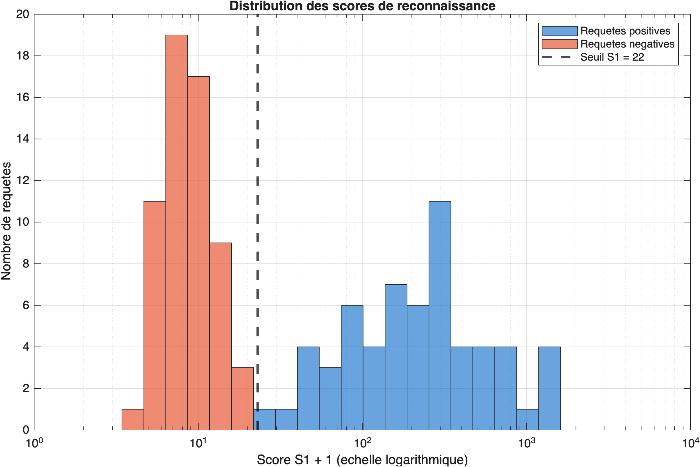


### Choix du seuil et courbe ROC

Le balayage du seuil sur la calibration donne TBD = 100 % et TFD = 0 %
pour tout seuil de 19 à 24. Le seuil de 22 se place dans ce palier, avec
une marge de 4 votes au-dessus du plus grand score négatif.

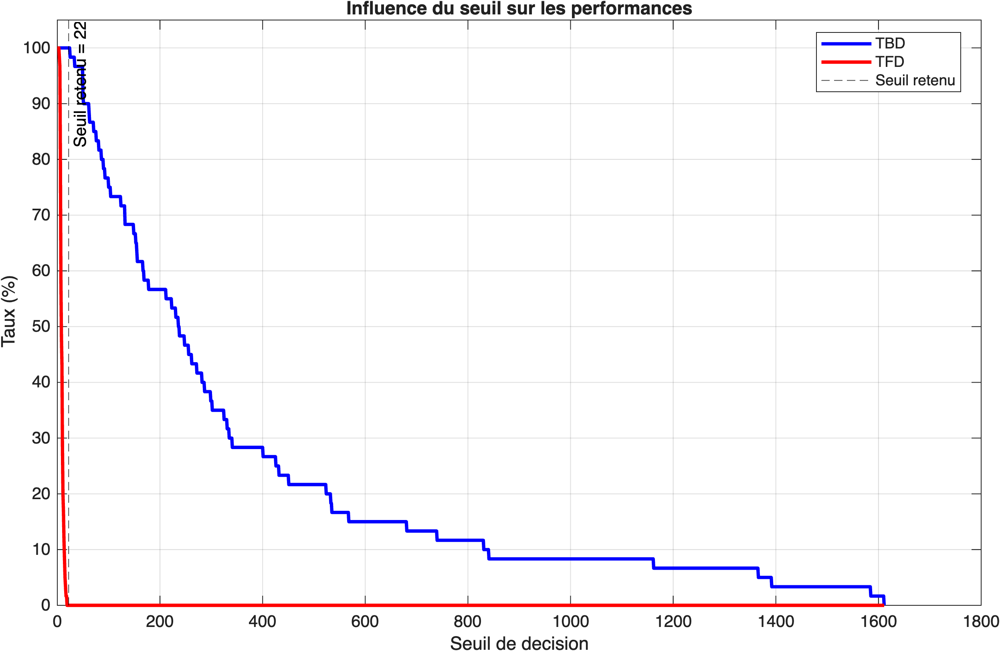

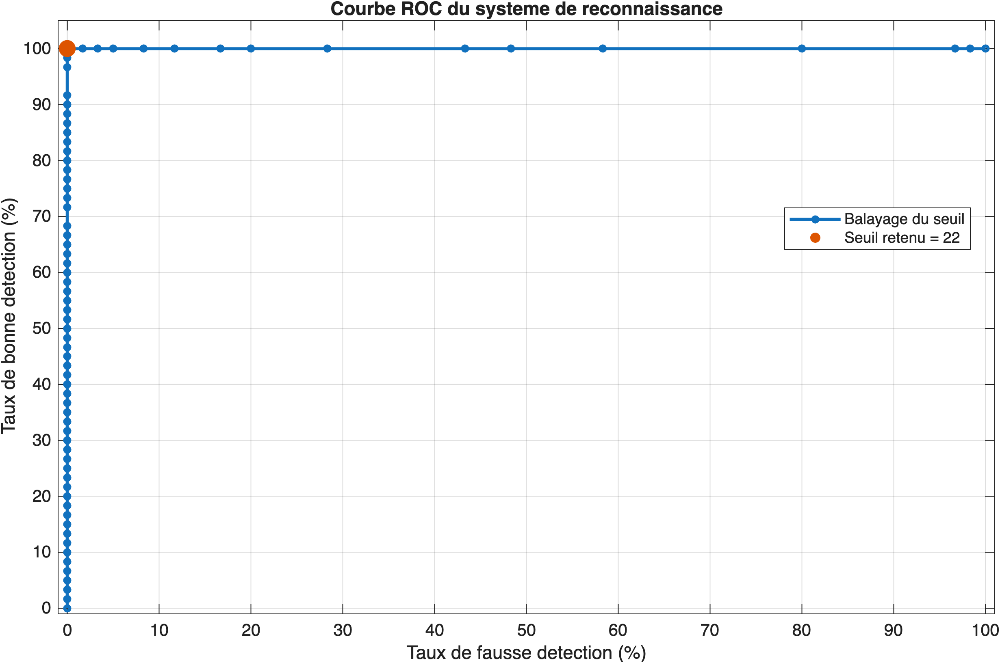

### Alignement temporel


### Influence de la durée des extraits

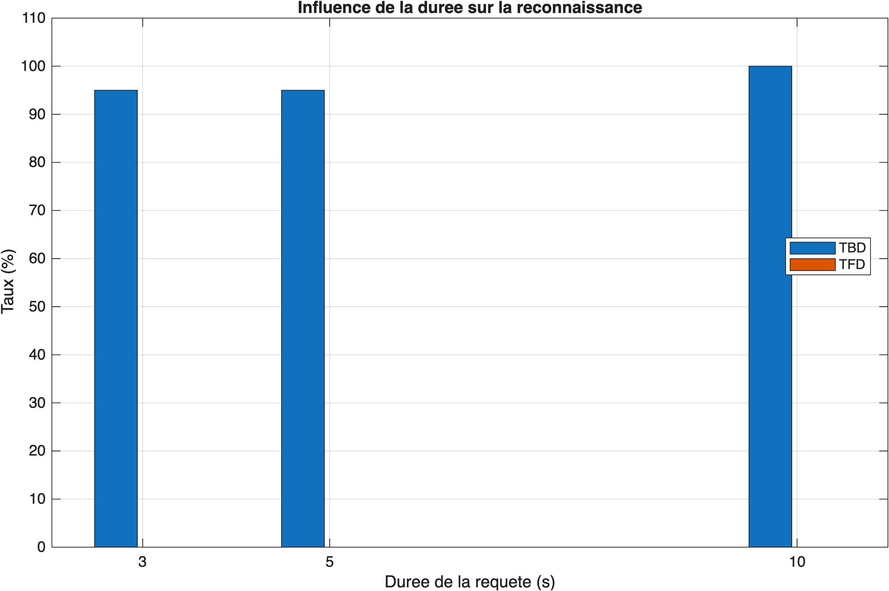

### Analyse par genre

Sur les 60 requêtes positives d'évaluation, le TBD vaut 100 % pour tous
les genres sauf Experimental (12/14, soit 85,71 %). Les deux échecs
proviennent du même morceau (n° 61). Les effectifs par genre sont trop
faibles (1 à 16 requêtes) pour conclure à un effet du genre.

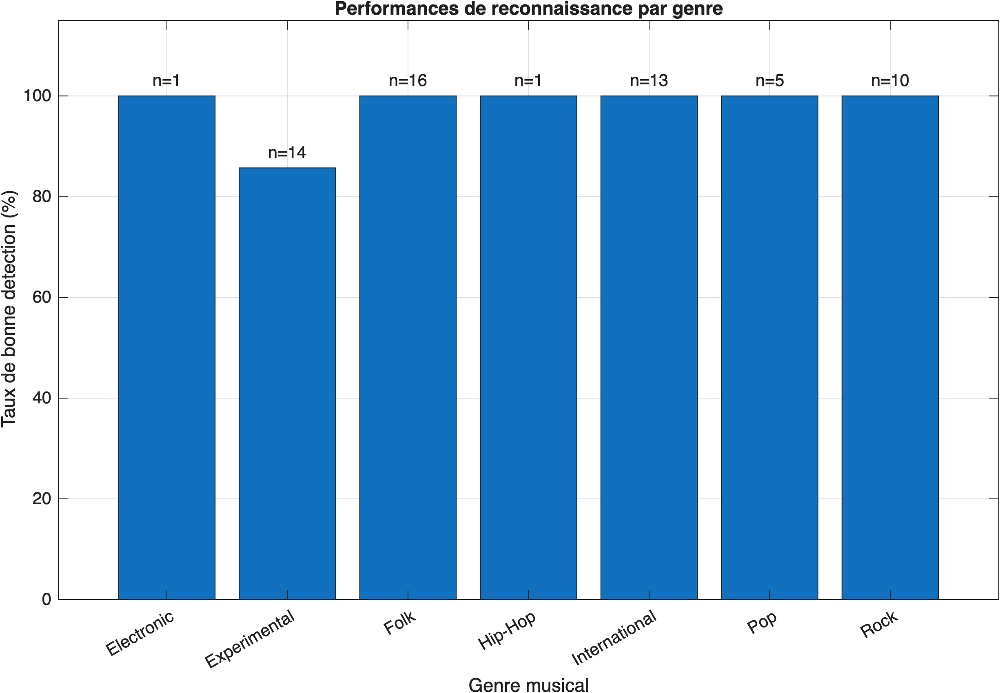

## 14. Étude de la robustesse

Le seuil reste fixé à 22 votes dans toutes les conditions.
TBD et TFD sur les 120 requêtes d'évaluation (durées confondues) :

| Dégradation | Paramètre | TBD | TFD |
|---|---|---:|---:|
| Sans dégradation | — | 96,67 % | 0 % |
| Bruit blanc | 30 dB | 98,33 % | 0 % |
| Bruit blanc | 20 dB | 98,33 % | 0 % |
| Bruit blanc | 15 dB | 98,33 % | 0 % |
| Bruit blanc | 10 dB | 96,67 % | 0 % |
| Bruit blanc | 5 dB | 90,00 % | 0 % |
| Bruit blanc | 0 dB | 78,33 % | 0 % |
| Bruit blanc | −5 dB | 53,33 % | 0 % |
| Passe-bas | 3 000 / 2 000 / 1 000 Hz | 98,33 / 96,67 / 98,33 % | 0 % |
| Bande téléphonique | 300–3 400 Hz | 98,33 % | 0 % |
| Volume | −20 / −6 / +6 dB | 96,67 % | 0 % |
| MP3 | 128 / 64 / 32 kbit/s | 98,33 / 100 / 98,33 % | 0 % |
| Réverbération | RT60 = 0,3 / 0,6 / 1 s | 95,00 / 93,33 / 91,67 % | 0 % |

Les valeurs supérieures au cas sans dégradation (98,33 %) s'expliquent
par la requête 41, dont le score est proche du seuil (18 votes) et varie
avec de faibles perturbations : il s'agit d'une seule requête sur 60.

### Bruit blanc : influence conjointe du RSB et de la durée

TBD des 60 requêtes positives par durée (20 requêtes par case),
y compris le point complémentaire à 15 dB :

| RSB | 3 s | 5 s | 10 s |
|---:|---:|---:|---:|
| 20 dB | 95 % | 100 % | 100 % |
| 15 dB | 95 % | 100 % | 100 % |
| 10 dB | 90 % | 100 % | 100 % |
| 5 dB | 80 % | 90 % | 100 % |
| 0 dB | 55 % | 80 % | 100 % |

Le nombre de votes corrects croît avec la durée de la requête, ce qui
compense la baisse de survie des pics quand le RSB diminue.

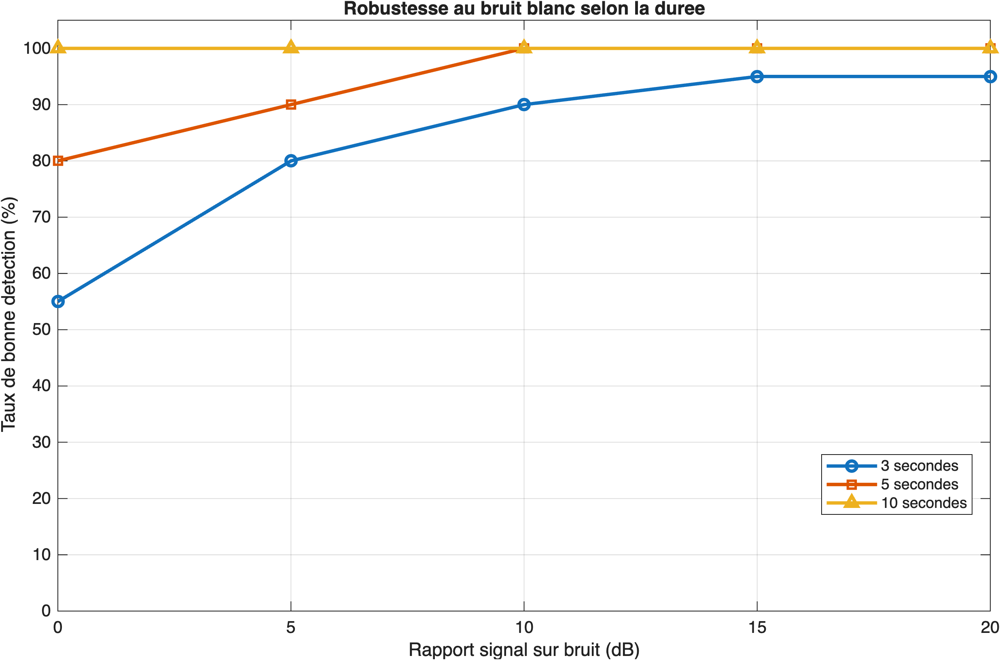

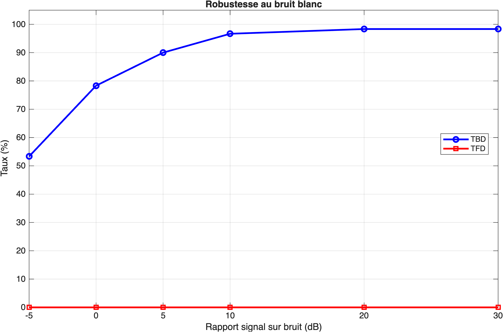

### Bruit réel (ambiance de bar)

| RSB | 3 s | 5 s | 10 s |
|---:|---:|---:|---:|
| 10 dB | 80 % | 95 % | 100 % |
| 5 dB | 70 % | 85 % | 100 % |
| 0 dB | 40 % | 65 % | 95 % |

Le TFD reste nul. Ce bruit dégrade davantage la reconnaissance qu'un
bruit blanc au même RSB, surtout pour les requêtes courtes. Un seul
enregistrement de bruit réel a été utilisé : cette observation reste à
confirmer.

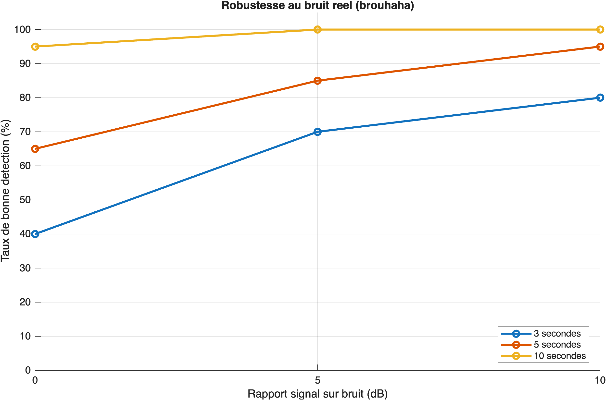

### Filtrage, volume, compression et réverbération

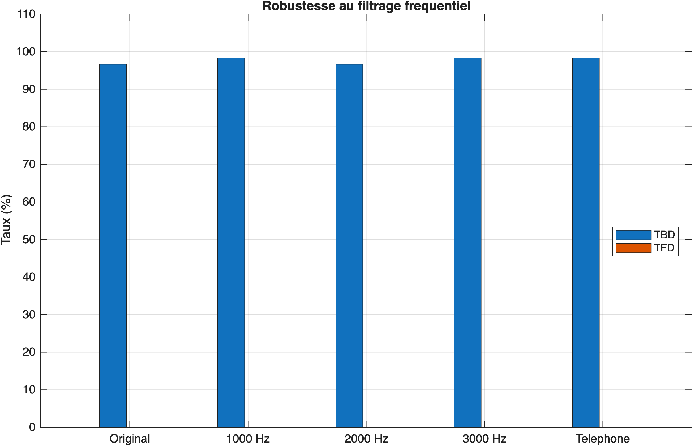

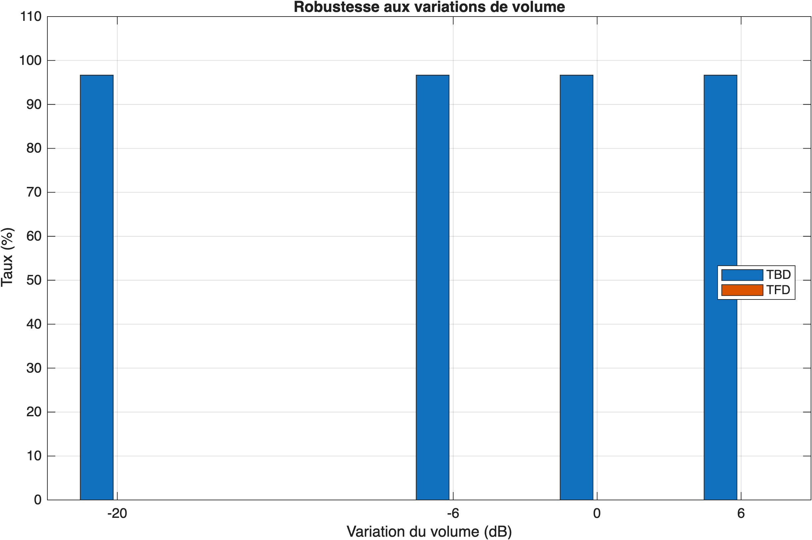

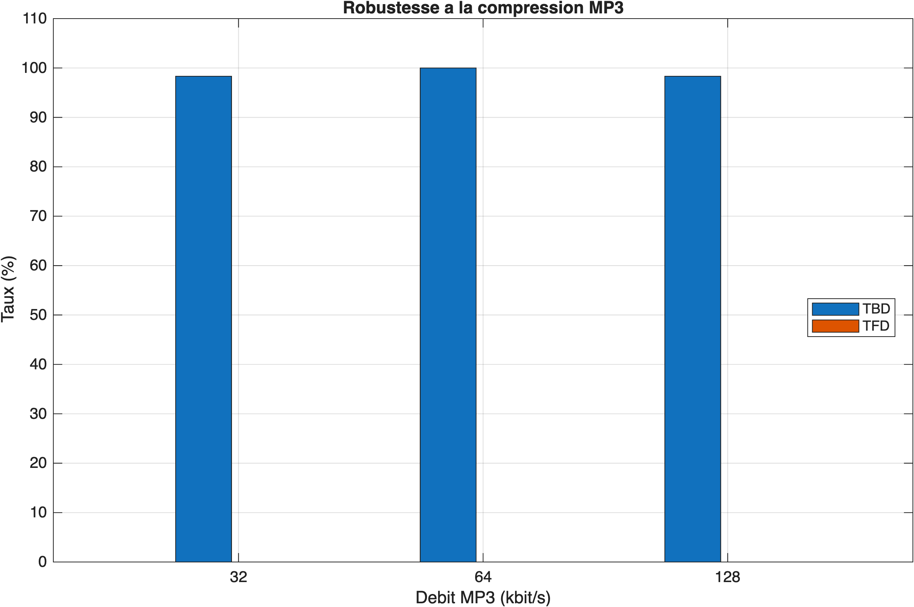

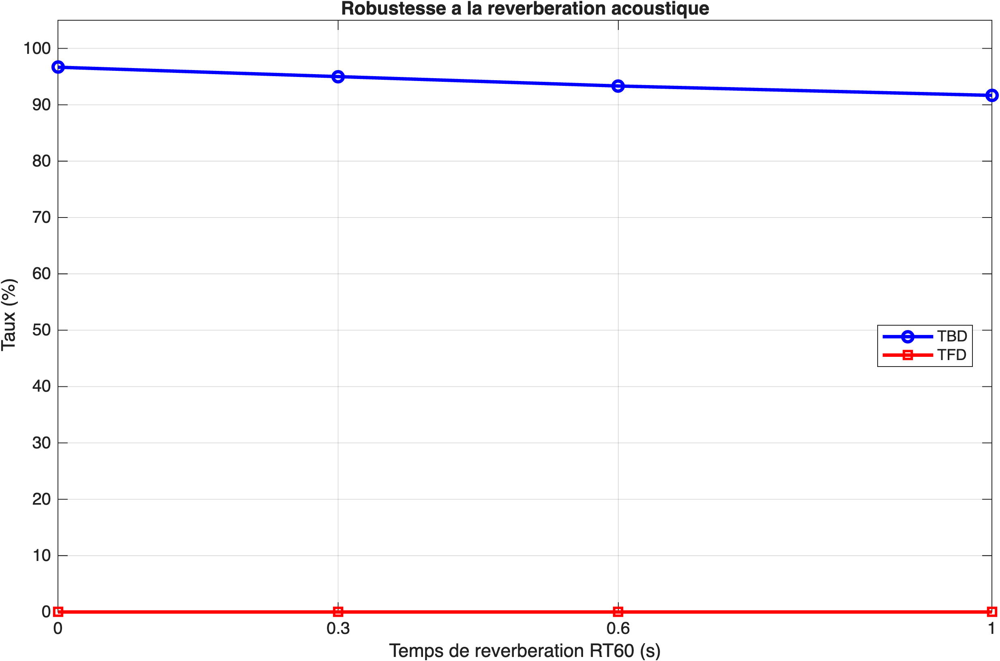

### Essais au microphone

Des essais qualitatifs ont été réalisés avec l'interface AudioID : un
morceau de la base diffusé par un téléphone et enregistré au micro de
l'ordinateur, puis un morceau absent de la base. Le rapport décrit
quatre acquisitions de 10 s : le morceau n° 19 est reconnu dans les deux
essais (S1 = 75 et 117 votes) et le morceau absent est rejeté dans les
deux essais (S1 = 10 et 7). Ces quatre essais montrent que la chaîne
fonctionne en conditions réelles, mais **ils sont trop peu nombreux pour
estimer un taux de reconnaissance**.

## 15. Analyse des cas d'échec

| Requête | Morceau réel | Durée | Score S1 | Score S2 |
|---|---:|---:|---:|---:|
| 16 | 61 | 3 s | 4 | 4 |
| 41 | 61 | 5 s | 18 | 4 |

- **Requête 16** : aucun alignement ne se distingue des appariements
  fortuits. Le spectrogramme est dense et peu contrasté : les pics
  dominent faiblement leur voisinage et très peu de paires correctes
  survivent.
- **Requête 41** : le pic d'alignement existe (S1 = 18 contre S2 = 4)
  mais reste sous le seuil. C'est un cas limite, qu'une requête plus
  longue ou une règle tenant compte du rapport S1/S2 permettrait de
  récupérer.


### Exemple de reconnaissance réussie

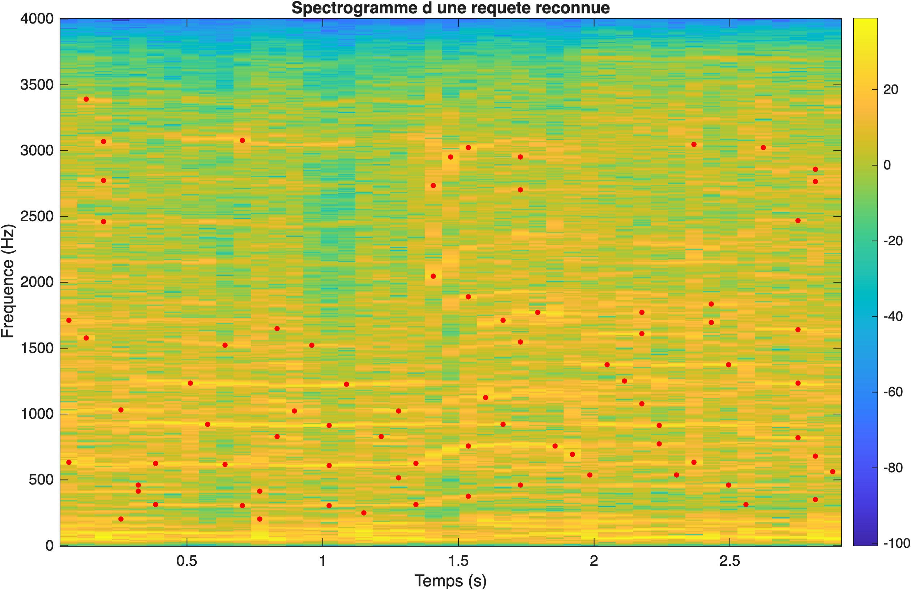

## 16. Interface graphique AudioID

L'interface (`gui/AudioID.m`, composants `uifigure`) est une couche de
présentation : elle appelle `recognize_query` sans modifier aucun
algorithme de `src/`, et le seuil affiché est celui de la configuration
sauvegardée. Elle fonctionne sans toolbox ni connexion Internet.

Lancement, fonctionnalités et procédure de test : section 9 et
`gui/README.md`.

## 17. Contribution distincte : `contributions/thomas/`

Le dossier `contributions/thomas/` conserve une **implémentation
distincte** de la génération des empreintes et de l'indexation :

- clé `uint32` avec quantification fréquentielle paramétrable γf
  (`generate_hashes.m`, `decode_key.m`) ;
- index en `containers.Map` et/ou en tableaux triés
  (`assemble_index.m`, `build_index.m`), avec une recherche par
  `ismember` (`query_index_v2.m`) ;
- tests des empreintes (`tests/test_hashes.m`) et scripts d'étude
  (`experiments/index_3songs.m`, `index_perf.m`, `exp_hash_params.m`).

**Cette implémentation n'est pas intégrée à la chaîne principale.**
Tous les résultats expérimentaux de ce dépôt et du rapport ont été
produits par `src/`.

Le rapport compare les deux versions : à γf = 1, elles produisent les
mêmes paires de pics pour les 100 morceaux et les mêmes scores S1, S2
pour 240 cas de test (120 requêtes, sans dégradation puis avec un bruit
blanc à 10 dB). L'index en tableaux triés occupe 12,5 Mo contre 46,8 Mo
pour le `containers.Map` sérialisé, et une recherche y prend 0,87 ms
contre 8,96 ms. Une intégration nécessiterait de convertir en `double`
les occurrences lues dans l'index `uint32` avant le calcul de δ, puis de
recalibrer le seuil.

`report/experiments/thomas_branch/` en est une copie identique (mêmes
fichiers `src/` et `tests/test_hashes.m`), utilisée par les scripts de
mesures complémentaires du rapport.

Ce dossier possède ses propres `config.m`, `main.m` et fonctions
homonymes : il doit être utilisé dans une session MATLAB séparée, depuis
son propre dossier, et jamais ajouté au chemin de la chaîne principale
(section 9).

## 18. Reproductibilité et gestion des données

- La configuration commune est centralisée dans `config.m` ; la
  configuration effectivement évaluée est sauvegardée avec l'index.
- Les requêtes sont tirées avec la graine 2026 ; leurs listes sont
  versionnées.
- Les résultats sont exportés en CSV et les figures en PNG (300 dpi).
- Les fichiers audio et l'index sont exclus du versionnement
  (`.gitignore`).
- Les mesures complémentaires du rapport (vérifications théoriques,
  survie des pics, influence de γf et de F, collisions, coût de l'index)
  sont produites par `report/experiments/` et enregistrées dans
  `report/results/`, avec les journaux d'exécution (section 10).
- Les figures composées du rapport (vérification de la propriété 2,
  étude du voisinage, bruit, scores, coût de l'index) ont été tracées à
  partir des CSV de `report/results/` et `results/` ; le script de tracé
  n'est pas versionné. Les données de chaque figure sont en revanche
  toutes présentes.
- Les figures `constellation_song01.png` à `constellation_song03.png`
  de l'étude de densité des pics étaient des fichiers vides dès leur
  commit d'origine et aucune version valide n'a été retrouvée : elles
  ont été retirées. Les résultats correspondants restent disponibles
  dans `results/tables/` et dans `fig_density_neighborhood.png` et
  `fig_survival_snr.png`.

## 19. Limites

- La bibliothèque est limitée à 100 morceaux et l'évaluation à 120
  requêtes (20 requêtes par durée et par condition) : les taux mesurés
  ont une précision limitée et ne doivent pas être généralisés.
- Les requêtes sont des extraits numériques des morceaux de référence ;
  seuls quatre essais ont été faits au microphone.
- Un seul enregistrement de bruit réel a été utilisé.
- La réverbération repose sur des réponses impulsionnelles synthétiques ;
  une salle réelle pourrait être plus pénalisante.
- Les expériences MP3 incluent un rééchantillonnage intermédiaire à
  44,1 kHz.
- Le seuil de 22 votes est calibré pour F = 10 et γf = 1 : tout
  changement de ces paramètres impose une nouvelle calibration.
- Les deux échecs proviennent du même morceau : l'analyse par genre ne
  permet pas de conclure à un effet du genre.
- Les temps de calcul ont été mesurés sur une seule machine.
- L'implémentation de `contributions/thomas/` n'est pas intégrée.
- La reproduction complète nécessite le dataset FMA Small : les requêtes
  WAV et les fichiers audio ne sont pas versionnés.

## 20. Perspectives

- Intégrer l'index en tableaux triés et la quantification γf, puis
  recalibrer le seuil.
- Ajouter un seuil local pour éliminer les pics faibles des passages calmes.
- Combiner S1 et le rapport S1/S2 dans la décision.
- Rendre le vote tolérant au partage entre δ0 et δ0 ± 1.
- Évaluer à plus grande échelle et en conditions réelles (salles,
  distances, plusieurs bruits, enregistrements au microphone).

## 21. Références bibliographiques

- Wang, A. L. (2003). An Industrial-Strength Audio Search Algorithm.
  Proceedings of ISMIR.
- Haitsma, J., & Kalker, T. (2002). A Highly Robust Audio Fingerprinting
  System. Proceedings of ISMIR.
- Cano, P., Batlle, E., Kalker, T., & Haitsma, J. (2005). A Review of
  Audio Fingerprinting. Journal of VLSI Signal Processing Systems.
- Harris, F. J. (1978). On the Use of Windows for Harmonic Analysis with
  the Discrete Fourier Transform. Proceedings of the IEEE.
- Müller, M. (2015). Fundamentals of Music Processing. Springer.
- Defferrard, M., Benzi, K., Vandergheynst, P., & Bresson, X. (2017).
  FMA: A Dataset for Music Analysis. Proceedings of ISMIR.
- DavidGreck, « Ambiance de Bar #1 », LaSonothèque, son n° 480,
  licence CC0. https://lasonotheque.org/ambiance-de-bar-1-s0480.html
- Documentation MATLAB : https://www.mathworks.com/help/matlab/
- Documentation FFmpeg : https://ffmpeg.org/documentation.html

## 22. Équipe

Projet réalisé dans le cadre de la formation d'ingénieur à ESIEE Paris,
année universitaire 2026/2027.

- Marie Alice Emilia AWADI
- Célya BAKALA-YAME
- Thomas BIJOU
