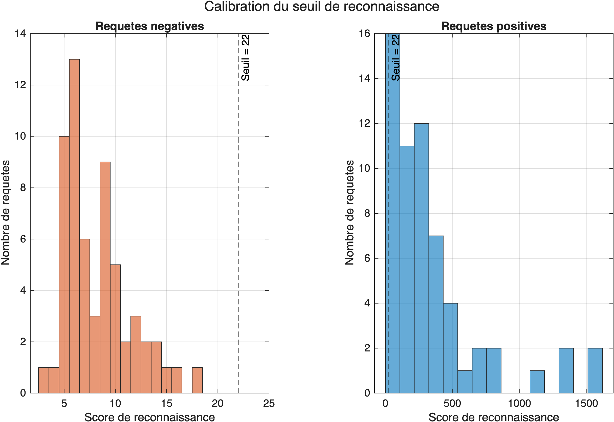
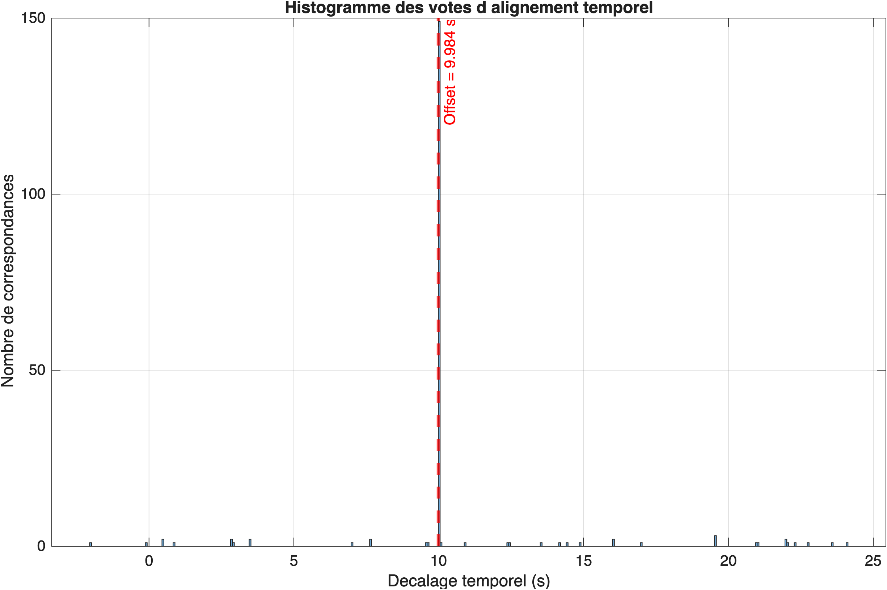
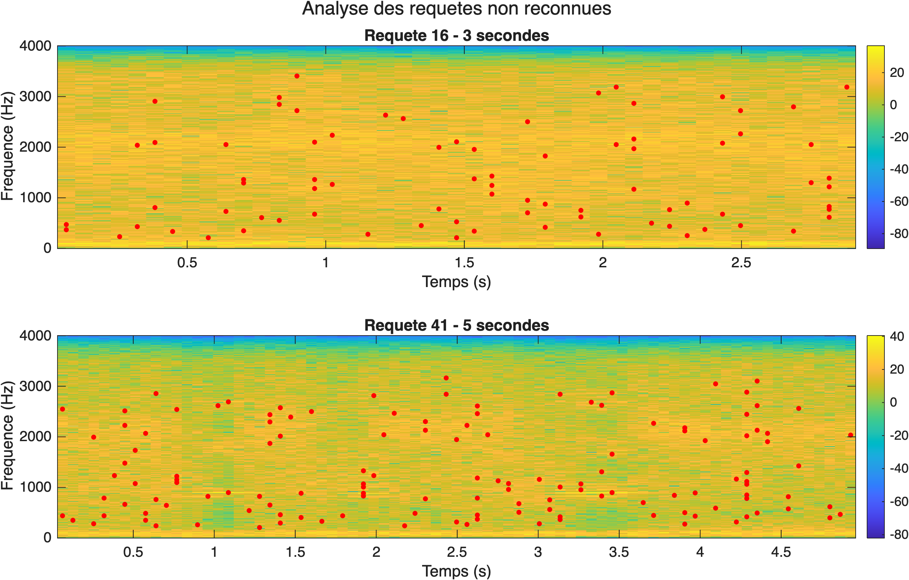

# Music Fingerprinting — MATLAB


Projet académique — ESIEE Paris  
Traitement du signal — Année 2026/2027

## 1. Présentation du projet

Ce projet consiste à développer un système de reconnaissance musicale
inspiré du fonctionnement de Shazam, basé sur l'extraction d'empreintes
acoustiques et leur comparaison avec une bibliothèque de référence.

Le système permet d'identifier un morceau à partir d'un court extrait
audio, d'estimer sa position temporelle dans le morceau original et
de rejeter les extraits absents de la bibliothèque.

Une attention particulière est portée à la robustesse de la reconnaissance
face aux différentes dégradations susceptibles d'affecter un signal audio
dans des conditions réelles d'utilisation.

## 2. Objectifs

- Identifier automatiquement un morceau à partir d'un extrait audio.
- Extraire des caractéristiques spectro-temporelles discriminantes.
- Générer des empreintes acoustiques compactes.
- Construire une base d'empreintes permettant une recherche rapide.
- Estimer le décalage temporel entre une requête et un morceau de référence.
- Distinguer les morceaux connus des morceaux inconnus.
- Calibrer expérimentalement un seuil de décision.
- Évaluer les performances et la robustesse du système.
- Développer une interface graphique facilitant son utilisation.

## 3. Principe de fonctionnement

Le système repose sur une chaîne de traitement composée des étapes
suivantes :

```text
Signal audio
     |
     v
Pretraitement du signal
     |
     v
Transformee de Fourier a court terme (TFCT)
     |
     v
Spectrogramme
     |
     v
Detection des maxima spectraux
     |
     v
Generation des empreintes acoustiques
     |
     v
Recherche dans la base de reference
     |
     v
Alignement temporel des correspondances
     |
     v
Calcul des scores de reconnaissance
     |
     v
Decision : morceau connu ou inconnu
```

### Prétraitement

Les signaux audio sont convertis en mono, rééchantillonnés,
centrés et normalisés afin d'homogénéiser les données traitées.

### Analyse temps-fréquence

La transformée de Fourier à court terme permet d'obtenir une
représentation spectro-temporelle du signal audio.

Les maxima spectraux sont ensuite sélectionnés afin de construire
une constellation de points caractéristiques.

### Empreintes acoustiques

Les empreintes sont générées à partir de couples de pics spectraux,
en exploitant leurs fréquences et leur différence temporelle.

### Indexation

Les empreintes des morceaux de référence sont stockées dans un index
associant chaque signature aux morceaux et positions temporelles
correspondants.

### Alignement temporel

Les correspondances entre les empreintes de la requête et celles
de la bibliothèque sont regroupées selon leur décalage temporel.

Un pic dominant dans l'histogramme des votes indique une forte
cohérence temporelle entre la requête et un morceau de référence.

### Décision

Le système compare le meilleur score de reconnaissance à un seuil
calibré expérimentalement.

Lorsque le score est inférieur au seuil, la requête est considérée
comme inconnue.

## 4. Technologies utilisées

- MATLAB
- Traitement numérique du signal
- Transformée de Fourier rapide (FFT)
- Analyse temps-fréquence
- Empreintes acoustiques
- Tables de hachage
- FFmpeg
- Git et GitHub

L'implémentation actuelle privilégie des fonctions compatibles
avec MATLAB sans dépendance à la Signal Processing Toolbox.

## 5. Structure du projet

```text
music-fingerprinting-matlab/
|
|-- config.m
|-- main.m
|-- README.md
|-- .gitignore
|
|-- src/
|   |-- preprocess_audio.m
|   |-- compute_spectrogram.m
|   |-- extract_peaks.m
|   |-- generate_hashes.m
|   |-- build_index.m
|   |-- query_index.m
|   |-- match_audio.m
|   |-- classify_match.m
|   |-- recognize_query.m
|   |-- apply_degradations.m
|   |-- apply_reverb.m
|
|-- data/
|   |-- metadata.csv
|   |-- references/
|   |-- negatives/
|   |-- queries/
|       |-- calibration/
|       |-- evaluation/
|       |-- calibration_list.csv
|       |-- evaluation_list.csv
|
|-- experiments/
|   |-- setup_database.m
|   |-- create_queries.m
|   |-- test_spectrogram.m
|   |-- calibrate_threshold.m
|   |-- sweep_threshold.m
|   |-- evaluate_system.m
|   |-- evaluate_robustness.m
|   |-- evaluate_mp3.m
|   |-- evaluate_reverb.m
|   |-- analyze_failure.m
|   |-- plot_results.m
|   |-- plot_robustness.m
|
|-- tests/
|   |-- test_alignment.m
|   |-- test_query_index.m
|   |-- test_end_to_end.m
|
|-- results/
|   |-- figures/
|   |-- calibration_scores.csv
|   |-- evaluation_scores.csv
|   |-- threshold_sweep.csv
|   |-- robustness_results.csv
|   |-- robustness_details.csv
|   |-- mp3_results.csv
|   |-- reverb_results.csv
|   |-- errors.csv
|
|-- gui/
|-- report/
|-- presentation/
```

## 6. Configuration du système

Les paramètres communs sont centralisés dans le fichier `config.m`.

| Paramètre | Valeur actuelle |
|---|---:|
| Fréquence d'échantillonnage | 8 000 Hz |
| Taille de fenêtre | 1 024 échantillons |
| Pas temporel | 512 échantillons |
| Taille de FFT | 1 024 |
| Fenêtre d'analyse | Hann |
| Fréquence minimale des pics | 200 Hz |
| Fréquence maximale des pics | 4 000 Hz |
| Nombre de bandes fréquentielles | 6 |
| Délai minimal entre les pics | 0,1 s |
| Délai maximal entre les pics | 2 s |
| Fan-out | 10 |
| Seuil expérimental du prototype | 22 votes |

Ces paramètres pourront évoluer lors de l'intégration finale.

## 7. Jeu de données

Les expérimentations utilisent le dataset FMA Small
(Free Music Archive).

Ce dataset contient 8 000 extraits musicaux d'environ
30 secondes appartenant à différents genres musicaux.

Source officielle :

https://github.com/mdeff/fma

### Bibliothèque de référence

La bibliothèque expérimentale est constituée de 100 morceaux.

Les morceaux supplémentaires sont utilisés pour générer
les requêtes négatives.

### Requêtes expérimentales

Deux ensembles distincts sont constitués afin de séparer
la calibration du seuil et l'évaluation des performances.

| Caractéristique | Calibration | Évaluation |
|---|---:|---:|
| Requêtes positives | 60 | 60 |
| Requêtes négatives | 60 | 60 |
| Extraits de 3 secondes | 40 | 40 |
| Extraits de 5 secondes | 40 | 40 |
| Extraits de 10 secondes | 40 | 40 |
| Total | 120 | 120 |

Nombre total de requêtes : 240.

La génération des requêtes utilise une graine aléatoire
fixée à 2026 pour favoriser la reproductibilité.

Les extraits positifs de calibration et d'évaluation sont
séparés temporellement.

Les morceaux utilisés pour les requêtes négatives sont
distincts entre les deux ensembles.

Les fichiers audio ne sont pas stockés sur GitHub.

## 8. Installation

### Prérequis

- MATLAB.
- Git.
- Dataset FMA Small.
- FFmpeg pour les expériences de compression MP3.

### Clonage du dépôt

```bash
git clone https://github.com/celya-bakala-yame/music-fingerprinting-matlab.git

cd music-fingerprinting-matlab
```

Pour accéder au prototype expérimental avant son intégration
dans la branche principale :

```bash
git switch celya/evaluation
```

### Installation de FFmpeg sur macOS

```bash
brew install ffmpeg
```

Vérification :

```bash
ffmpeg -version
```

Si MATLAB ne détecte pas FFmpeg sur un Mac Apple Silicon :

```matlab
setenv('PATH', ['/opt/homebrew/bin:' getenv('PATH')]);
```

### Initialisation de MATLAB

Ouvrir MATLAB à la racine du projet, puis exécuter :

```matlab
addpath('src');
cfg = config();
```

## 9. Reproduction des expériences

Les scripts suivants doivent être exécutés dans l'ordre
depuis la racine du projet.

### Construction de la base de référence

```matlab
run('experiments/setup_database.m')
```

Sélectionner le dossier contenant le dataset `fma_small`.

### Génération des requêtes

```matlab
run('experiments/create_queries.m')
```

### Calibration du seuil

```matlab
run('experiments/calibrate_threshold.m')
run('experiments/sweep_threshold.m')
```

### Évaluation indépendante

```matlab
run('experiments/evaluate_system.m')
run('experiments/plot_results.m')
```

### Évaluation de la robustesse

```matlab
run('experiments/evaluate_robustness.m')
run('experiments/plot_robustness.m')
run('experiments/evaluate_mp3.m')
run('experiments/evaluate_reverb.m')
```

### Analyse des échecs

```matlab
run('experiments/analyze_failure.m')
```

Le script actuel analyse les requêtes 16 et 41,
identifiées comme des échecs lors de l'évaluation initiale.

Ces identifiants devront être actualisés si les résultats
changent après l'intégration finale.

### Validation fonctionnelle

```matlab
run('tests/test_query_index.m')
run('tests/test_alignment.m')
run('tests/test_end_to_end.m')
```

### Sauvegarde de l'index calibré

```matlab
save('results/fingerprint_index.mat', ...
    'index', 'cfg', 'audio_files', '-v7.3');
```

L'index doit être sauvegardé après la calibration afin
d'inclure le seuil de reconnaissance retenu.

### Lancement du programme principal

```matlab
main
```

Une fenêtre permet de sélectionner un fichier audio.

Le programme affiche ensuite :

- Le résultat de la reconnaissance.
- L'identifiant du morceau reconnu.
- Le titre, lorsque les métadonnées sont disponibles.
- Le meilleur score de reconnaissance.
- Le deuxième score.
- Le décalage temporel estimé.
- Le temps de traitement.
- Le spectrogramme et les pics spectraux.

## 10. Interface de reconnaissance

La fonction principale du pipeline est :

```matlab
[result, diag] = recognize_query(x, Fs, index, cfg);
```

### Entrées

| Variable | Description |
|---|---|
| `x` | Signal audio à reconnaître |
| `Fs` | Fréquence d'échantillonnage du signal |
| `index` | Base d'empreintes acoustiques |
| `cfg` | Configuration du système |

### Résultat

La structure `result` contient :

| Champ | Description |
|---|---|
| `song_id` | Identifiant du morceau reconnu |
| `title` | Titre du morceau |
| `score` | Meilleur score de reconnaissance |
| `score2` | Deuxième score |
| `offset_s` | Décalage temporel estimé en secondes |
| `is_known` | Indicateur de reconnaissance |

### Diagnostics

La structure `diag` contient notamment :

- Le spectrogramme.
- Les axes temporel et fréquentiel.
- Les pics spectraux.
- Les empreintes générées.
- Les correspondances trouvées dans l'index.
- Les résultats de l'alignement temporel.

Ces informations permettent d'analyser les décisions
du système et d'alimenter l'interface graphique.

Une ancienne signature de la fonction reste disponible
pour assurer la compatibilité avec les scripts expérimentaux :

```matlab
result = recognize_query(index, keys, m_query, cfg);
```

## 11. Métriques d'évaluation

### Taux de bonne détection (TBD)

Proportion des requêtes positives correctement identifiées.

```text
TBD = Nombre de requetes positives correctement reconnues
      / Nombre total de requetes positives
```

### Taux de fausse détection (TFD)

Proportion des requêtes négatives acceptées à tort.

```text
TFD = Nombre de requetes negatives acceptees
      / Nombre total de requetes negatives
```

### Accuracy

Proportion globale de décisions correctes.

### Temps de reconnaissance

Temps nécessaire au traitement d'une requête,
hors construction et chargement de l'index.

## 12. Résultats expérimentaux préliminaires

Les résultats suivants ont été obtenus sur un ensemble
indépendant de 120 requêtes en conditions non dégradées.

| Indicateur | Résultat |
|---|---:|
| Morceaux de référence | 100 |
| Requêtes d'évaluation | 120 |
| Seuil de reconnaissance | 22 votes |
| Requêtes positives reconnues | 58/60 |
| Requêtes négatives correctement rejetées | 60/60 |
| Taux de bonne détection | 96,67 % |
| Taux de fausse détection | 0,00 % |
| Accuracy globale | 98,33 % |
| Temps moyen de reconnaissance | 18 ms |

Ces résultats correspondent à une version préliminaire
du système et devront être confirmés après l'intégration
définitive des différents modules.

### Distribution des scores de reconnaissance



### Influence du seuil de décision


### Alignement temporel



### Influence de la durée des extraits


## 13. Étude de la robustesse

Le système est évalué face à différentes dégradations audio.

| Dégradation | Paramètres expérimentaux |
|---|---|
| Bruit blanc additif | -5, 0, 5, 10, 20 et 30 dB |
| Filtrage passe-bas | 1 000, 2 000 et 3 000 Hz |
| Bande téléphonique | 300 à 3 400 Hz |
| Variations de volume | -20, -6 et +6 dB |
| Compression MP3 | 32, 64 et 128 kbit/s |
| Réverbération | RT60 de 0,3, 0,6 et 1 s |

Le seuil de reconnaissance reste constant pendant
les expériences afin de comparer les performances
dans les différentes conditions.

### Robustesse au bruit


### Robustesse au filtrage fréquentiel


### Robustesse aux variations de volume


### Robustesse à la compression MP3


### Robustesse à la réverbération


## 14. Analyse des cas d'échec

Deux faux rejets ont été observés lors de l'évaluation
initiale en conditions non dégradées.

| Requête | Morceau réel | Durée | Score S1 | Score S2 |
|---|---:|---:|---:|---:|
| 16 | 61 | 3 s | 4 | 4 |
| 41 | 61 | 5 s | 18 | 4 |

Les deux requêtes correspondent au même morceau de référence.

Leurs scores étant inférieurs au seuil de 22 votes,
elles ont été classées comme inconnues.

Une analyse spectro-temporelle permet d'examiner
les caractéristiques de ces extraits.



### Exemple de reconnaissance réussie


## 15. Tests et validation

Le projet comprend des tests portant sur :

- La recherche des empreintes dans l'index.
- L'alignement temporel des correspondances.
- La reconnaissance d'un morceau connu.
- L'estimation du décalage temporel.
- Le rejet d'un morceau inconnu.
- Le chargement et la sauvegarde de l'index.

Le test de bout en bout utilise une tolérance
de 0,1 seconde pour l'estimation du décalage temporel.

## 16. Interface graphique

Une interface graphique est prévue afin de rendre
le système accessible sans manipulation directe
des scripts MATLAB.

Fonctionnalités prévues :

- Chargement de la bibliothèque d'empreintes.
- Sélection d'un fichier audio.
- Acquisition audio depuis le microphone.
- Identification automatique du morceau.
- Affichage des scores de reconnaissance.
- Affichage du décalage temporel.
- Visualisation du spectrogramme.
- Visualisation des pics spectraux.
- Visualisation de l'alignement temporel.
- Gestion des morceaux inconnus.

Le développement de cette interface est isolé
sur une branche Git dédiée.

## 17. Reproductibilité et gestion des données

Les résultats expérimentaux sont exportés au format CSV.

Les figures scientifiques sont enregistrées au format PNG,
avec une résolution de 300 dpi.

Les fichiers audio et les index volumineux générés
localement sont exclus du versionnement Git.

La configuration commune est centralisée dans `config.m`.

Les scripts expérimentaux permettent de reconstruire
les données et de reproduire les évaluations.

## 18. Limites actuelles

- La bibliothèque expérimentale est limitée à 100 morceaux.
- Les fonctions provisoires de génération des empreintes
  et d'indexation doivent être remplacées ou validées
  lors de l'intégration collective.
- Le filtrage fréquentiel repose sur des filtres FIR
  à fenêtre de Hamming, sans Signal Processing Toolbox.
- Les expériences MP3 incluent un rééchantillonnage
  intermédiaire à 44,1 kHz.
- La réverbération repose sur des réponses impulsionnelles
  synthétiques.
- Les tests réels au microphone restent à compléter.
- L'intégration des métadonnées musicales reste à finaliser.
- L'ordre des fichiers de référence doit être vérifié
  pour garantir la correspondance des identifiants.
- Les résultats devront être recalculés après
  l'intégration définitive des modules.

## 19. Perspectives d'amélioration

- Augmentation de la taille de la bibliothèque musicale.
- Optimisation du temps de construction de l'index.
- Réduction de l'occupation mémoire.
- Optimisation des paramètres de génération des empreintes.
- Amélioration de la robustesse aux conditions acoustiques.
- Étude de stratégies de décision complémentaires.
- Intégration complète des métadonnées musicales.
- Reconnaissance en temps réel depuis un microphone.
- Finalisation de l'interface graphique.

## 20. Organisation du développement

Le projet est développé collaborativement avec Git et GitHub.

Les fonctionnalités sont développées sur des branches
distinctes avant leur intégration dans la branche principale.

Les paramètres et contrats d'interface sont définis
collectivement afin de garantir la compatibilité
des différents modules.

## 21. Références bibliographiques

- Wang, A. L. (2003).
  An Industrial-Strength Audio Search Algorithm.
  Proceedings of ISMIR.

- Haitsma, J., & Kalker, T. (2002).
  A Highly Robust Audio Fingerprinting System.
  Proceedings of ISMIR.

- Cano, P., Batlle, E., Kalker, T., & Haitsma, J. (2005).
  A Review of Audio Fingerprinting.
  Journal of VLSI Signal Processing Systems.

- Harris, F. J. (1978).
  On the Use of Windows for Harmonic Analysis
  with the Discrete Fourier Transform.
  Proceedings of the IEEE.

- Defferrard, M., Benzi, K., Vandergheynst, P.,
  & Bresson, X. (2017).
  FMA: A Dataset for Music Analysis.
  Proceedings of ISMIR.

- Documentation MATLAB :
  https://www.mathworks.com/help/matlab/

- Documentation FFmpeg :
  https://ffmpeg.org/documentation.html

## 22. Équipe

Projet réalisé dans le cadre de la formation
d'ingénieur à ESIEE Paris.

- Célya Bakala-Yame
- Millie
- Thomas

Année universitaire 2026/2027.